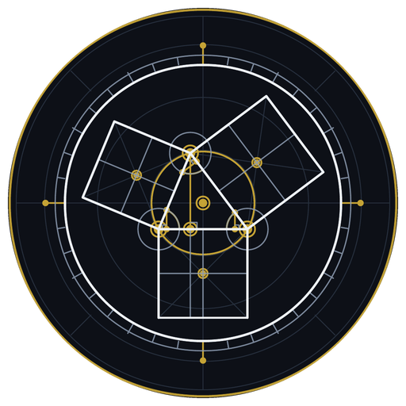

<a href="https://geometor.github.io/wildberger/"></a>

# GEOMETOR • wildberger

**Visit the Online Archive:** https://geometor.github.io/wildberger/

<p align="center">
  <a href="https://geometor.github.io/wildberger/"></a>
</p>

**Norman J. Wildberger • Divine Proportions & Rational Trigonometry • semantic digital archive**

## Mission

`geometor/wildberger` is part of the interconnected [GEOMETOR](https://geometor.com) semantic digital archive. It provides a 100% exact symbolic synthesis of Norman J. Wildberger's Rational Trigonometry, Universal Geometry, and Chromogeometry—formulating geometry over arbitrary fields using quadrance and spread without transcendental approximations. By translating foundational treatises and lecture series into executable algebraic certificates, interactive vector diagrams, and verified multivariate theorems, the repository establishes a computable rational foundation across the GEOMETOR corpus.

## Catalogs in This Archive

- [Principles of Rational Trigonometry & Universal Geometry](https://geometor.github.io/wildberger/topics/) — 28 executable geometric principles (`W.01`–`W.28`) proved in exact SymPy algebra with interactive dark-canvas vector figures.

## Repository Contents

- `docsrc/` — RST tracks and catalog pages compiled by [PHOTON publish](https://github.com/photon-platform/publish).
- `src/geometor/wildberger/` — Symbolic core modules, theorem provers, invariant calculators, and CLI tools.

## Local Build & Verification

```bash
publish build
uv run --no-sync pytest
```
## Part of the GEOMETOR Knowledge Archive

Explore all **74 Book Codices** and **11 Mathematical Catalogs** at https://geometor.com/books/.
