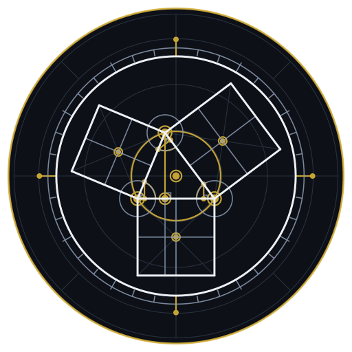

:site_title: Norman J. Wildberger

.. container:: author-overline

   semantic digital archive • mathematical catalog

====================
Norman J. Wildberger
====================

**Norman J. Wildberger** (b. 1955) reformulated classical geometry and trigonometry without transcendental circular functions or irrational distances—replacing length and angle with **quadrance** and **spread**. **geometor.wildberger** translates his *Divine Proportions* (2005), *Universal Hyperbolic Geometry*, and *Chromogeometry* into 28 executable principles (``W.01``–``W.28``) proved over arbitrary fields in 100% exact ``SymPy`` algebra.

Catalog & Executable Principles
-------------------------------

.. container:: home-book-hero

   .. container:: home-book-thumb

      .. image:: topics/w-01/w-01.svg
         :alt: W.01 Planar Points, Line Proportions and Incidence Determinants Diagram
         :target: topics/index.html

   .. container:: home-book-body

      .. rubric:: 2-Track Book Codex · W.01–W.28 · Synthesis & SymPy Code

      **Principles of Rational Trigonometry & Universal Geometry** — Explore all 28 principles across four progressive parts—from affine incidence, quadrance, and spread polynomials through the Five Fundamental Laws, triangle centers over :math:`\mathbb{Q}` and :math:`\mathbb{F}_p`, rational surveying, and Platonic dihedral spreads.

      .. container:: home-actions

         * :doc:`Browse All 28 Principles → <topics/index>`
         * :doc:`Start at W.01 (Incidence) → <topics/w-01/index>`
         * :doc:`W.06 (Pythagoras' Theorem) → <topics/w-06/index>`

.. container:: home-book-hero

   .. container:: home-book-thumb

      .. image:: topics/w-23/w-23.svg
         :alt: W.23 Chromogeometry Blue, Red and Green Metrics Diagram
         :target: topics/w-23/index.html

   .. container:: home-book-body

      .. rubric:: Chromogeometry & Algebraic Certificates · Python Toolkit

      **Universal Bilinear Forms & Python API** — Inspect how Blue (Euclidean), Red (Lorentzian), and Green (Hyperbolic) geometries share unified polynomial laws, trace Kepler's golden right triangle in rational invariants, and run the symbolic theorem provers directly via ``geometor.wildberger``.

      .. container:: home-actions

         * :doc:`W.23 (Chromogeometry) → <topics/w-23/index>`
         * :doc:`W.11 (Kepler's Golden Triangle) → <topics/w-11/index>`
         * :doc:`Python API Reference → <modules/index>`

Key Features
------------

.. container:: home-feature-grid

   .. container:: home-feature-card

      **Purely Polynomial Invariants**

      Replace :math:`\sin`, :math:`\cos`, and square roots with quadratic quadrance :math:`Q` and spread :math:`s` valid over :math:`\mathbb{Q}`, finite fields :math:`\mathbb{F}_p`, and symbolic rings.

   .. container:: home-feature-card

      **The Five Fundamental Laws**

      Executable SymPy proofs for Pythagoras' Theorem, the Triple Quad Formula, the Spread Law, the Cross Law, and the Triple Spread Formula.

   .. container:: home-feature-card

      **Synchronized Synthesis & Code**

      Every topic pairs its formal enunciation, signature, and interactive vector figure with a standalone ``model.py`` SymPy script.

Reference & Project
-------------------

.. container:: home-columns

   .. container:: home-col

      .. rubric:: Scholarly Apparatus

      * :doc:`People <people/index>` — Profiles of Norman J. Wildberger, Archimedes, Apollonius, René Descartes, and Arthur Cayley
      * :doc:`Bibliography <bibliography>` — *Divine Proportions* (2005), *Universal Hyperbolic Geometry*, and research papers
      * :doc:`Glossary <glossary>` — Definitions of quadrance, spread, cross, twist, quadrea, and chromogeometric metrics

   .. container:: home-col

      .. rubric:: About & Developer

      * :doc:`About This Edition <about/index>` — Scope, field-independent architecture, and GEOMETOR links
      * :doc:`Using This Edition <usage/index>` — Guide to reading tracks, navigation, and collection views
      * :doc:`Research Log <log/index>`, :doc:`Python Modules <modules/index>` & :doc:`Changelog <changelog>` — Development notes and release history

.. toctree::
   :maxdepth: 2
   :hidden:

   topics/index
   about/index
   usage/index
   glossary
   people/index
   bibliography
   log/index
   modules/index
   changelog
