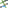

====================================================================
W.01 Planar Points, Line Proportions & Incidence Determinants — Code
====================================================================

.. enunciation::

   Over any field F of characteristic not equal to 2, a planar point is an ordered pair A = [x, y] and a planar line is a homogeneous 3-proportion l = <a : b : c> with (a, b) != (0, 0) representing a*x + b*y + c = 0; three points are collinear and three lines are concurrent if and only if their respective 3x3 coordinate determinants vanish.

   Exact ``geometor.model`` SVG output of ``model.py`` for **W.01 (Planar Points, Line Proportions & Incidence Determinants)**.

Symbolic Construction & Verification Script (``model.py``)
----------------------------------------------------------

.. literalinclude:: model.py
   :language: python
