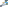

=========================================================
W.04 Spread, Cross, Twist & Line Separation Ratios — Code
=========================================================

.. enunciation::

   For two non-null lines l_1 = <a_1 : b_1 : c_1> and l_2 = <a_2 : b_2 : c_2>, the spread s(l_1, l_2) = (a_1*b_2 - a_2*b_1)^2 / ((a_1^2 + b_1^2)*(a_2^2 + b_2^2)) depends only on the unoriented lines, vanishes iff l_1 || l_2, equals 1 iff l_1 perp l_2, and equals Q(B, C) / Q(A, B) for any altitude BC dropped from B on l_1 to C on l_2.

   Exact ``geometor.model`` SVG output of ``model.py`` for **W.04 (Spread, Cross, Twist & Line Separation Ratios)**.

Symbolic Construction & Verification Script (``model.py``)
----------------------------------------------------------

.. literalinclude:: model.py
   :language: python
