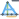

=======================================================================
W.07 Law II: Triple Quad Formula, Archimedes' Function & Quadrea — Code
=======================================================================

.. enunciation::

   Three planar points A_1, A_2, A_3 with pairwise quadrances Q_1, Q_2, Q_3 are collinear if and only if Archimedes' symmetric quadratic form A(Q_1, Q_2, Q_3) = (Q_1 + Q_2 + Q_3)^2 - 2(Q_1^2 + Q_2^2 + Q_3^2) vanishes; for any triangle, A(Q_1, Q_2, Q_3) equals 4 times the squared coordinate determinant (16 * Delta^2), defining the triangle's quadrea.

   Exact ``geometor.model`` SVG output of ``model.py`` for **W.07 (Law II: Triple Quad Formula, Archimedes' Function & Quadrea)**.

Symbolic Construction & Verification Script (``model.py``)
----------------------------------------------------------

.. literalinclude:: model.py
   :language: python
