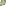

:order: 25
:type: topic
:category: Geodetic Resection & Two-Station Surveying
:tags: Snellius-Pothenot, resection, Hansen's problem, surveying, Alternate Spreads

.. _w-25:

=============================================================
W.25 Snellius–Pothenot Resection & Hansen's Surveying Problem
=============================================================

*Exact Algebraic Coordinate Recovery from Unmeasured Stations via Spread Triples*

.. enunciation::

   In Snellius-Pothenot resection, an observer P measuring spreads to three known beacons A, B, C lies on the algebraic intersection of two subtended-spread conics; in Hansen's problem, knowing one baseline quadrance Q(A, B) and four sighting spreads at unobserved stations C, D determines every side and diagonal quadrance exactly via Triple Spread Systems and Alternate Spreads.

   Interactive GEOMETOR construction for **W.25 (Snellius–Pothenot Resection & Hansen's Surveying Problem)**. Hover any geometric label in the text or figure to highlight the corresponding element.

.. signature::

   A : Point
   B : Point
   C : Point
   D : Point
   =====
   q_hansen = polygon(A, B, C, D)
   d_ac = segment(A, C)
   d_bd = segment(B, D)

Mathematical Synthesis
----------------------

Two famous benchmarks of 17th–19th century geodesy showcase the computational power of Rational Trigonometry (:cite:`Wildberger2005`). In :person:`Willebrord Snellius <snellius>`' resection problem (1615, later revisited by Pothenot), an observer measures spreads :math:`r_1 = s(P A, P B)` and :math:`r_2 = s(P B, P C)` toward three known landmarks; each spread defines an explicit circumcircle chord locus (:ref:`W.17 <w-17>`), reducing resection to circle-circle intersection.

In :person:`Peter Andreas Hansen <hansen>`'s two-station problem (1841), landmarks :g:`A` and :g:`B` have known quadrance :math:`Q(A, B) = 26`, while an observer at unknown stations :g:`C` and :g:`D` (:g:`q_hansen`, diagonals :g:`d_ac`, :g:`d_bd`) measures only the rational spreads among lines :math:`C A, C B, C D` and :math:`D A, D B, D C`. Combining two :term:`Triple Spread Formula` relations with the **Alternate Spreads** ratio (:ref:`W.14 <w-14>`) recovers all four unknown quadrances (:math:`Q(A,D)=17, Q(B,C)=17, Q(A,C)=41, Q(B,D)=25`) with zero rounding error!

Key Algebraic Identities
------------------------

.. math::

   \frac{s(C A, C B)\, s(C B, C D)\, s(D A, A C)}{s(D A, D B)\, s(C D, C A)\, s(D B, B C)} = \frac{x}{y} \quad (\text{Spread Law Ratio Elimination})

.. math::

   Q(A, D) = Q(A, B)\,\frac{y}{s(D A, D B)}, \qquad Q(B, C) = Q(A, B)\,\frac{x}{s(C A, C B)}

Symbolic ``SymPy`` Verification
-------------------------------

.. list-table::
   :widths: 36 36 28
   :header-rows: 1

   * - Invariant / Theorem Check
     - Exact ``SymPy`` Value
     - Verification Status
   * - ``Known baseline quadrance Q(A, B)``
     - ``26``
     - A=[0,0], B=[1,5]
   * - ``Observed rational spreads at C & D``
     - ``441/697, 169/170, 361/425, 121/170``
     - Pure rational sightings
   * - ``Recovered Q(A,D), Q(B,C), Q(A,C), Q(B,D)``
     - ``17, 17, 41, 25``
     - 100% exact match with zero trig!
   * - ``Snellius-Pothenot resection residual at D``
     - ``0``
     - Verified == 0

Cross-Repository Canon
----------------------

.. list-table::
   :widths: 28 72

   * - **Executable Demonstration**
     - :doc:`code` (Standalone ``model.py`` & ``w-25.svg``)
   * - **Thematic Part**
     - Part IV: Practical Solvers, 3D Platonic Geometry & Polar Curves
   * - **Geodetic Canon**
     - :person:`Willebrord Snellius <snellius>` (1615) & :person:`Peter Andreas Hansen <hansen>` (1841)
   * - **GEOMETOR Elements**
     - :ref:`G.3`, :ref:`G.7`
   * - **GEOMETOR Fundamentals**
     - :ref:`F.7 Ceva and Menelaus <f-07>`, :ref:`F.12 Coaxial Circles <f-12>`
   * - **Exact Solver**
     - Verified symbolically in ``geometor.wildberger.solvers.solve_hansen_benchmark``

Constructive Dependency Graph
-----------------------------

.. graphviz::

   digraph dependency {
       rankdir=TB;
       bgcolor="transparent";
       node [fontname="Helvetica,Arial,sans-serif", fontsize=10, shape=box, style="rounded,filled", margin="0.15,0.08"];
       edge [color="#888888", arrowsize=0.7];
       "W.10" [label="W.10\nLaw V: Triple Spread, Triple Cr...", fillcolor="#d8dee9", color="#4c566a", URL="../w-10/index.html"];
       "W.14" [label="W.14\nMenelaus, Ceva & The Alternate...", fillcolor="#d8dee9", color="#4c566a", URL="../w-14/index.html"];
       "W.17" [label="W.17\nCircle Geometry: Subtended Spre...", fillcolor="#d8dee9", color="#4c566a", URL="../w-17/index.html"];
       "W.24" [label="W.24\nExact Triangle Solvers & Survey...", fillcolor="#d8dee9", color="#4c566a", URL="../w-24/index.html"];
       "W.25" [label="W.25\nSnellius–Pothenot Resection & H...", fillcolor="#ffff99", color="#d4a017", penwidth=2.0, URL="../w-25/index.html"];
       "W.10" -> "W.25";
       "W.14" -> "W.25";
       "W.17" -> "W.25";
       "W.24" -> "W.25";
   }

**Depends on**: :ref:`W.10 Law V: Triple Spread, Triple Cross & Quadruple Spread Formulas <w-10>`, :ref:`W.14 Menelaus, Ceva & The Alternate Spreads Theorem <w-14>`, :ref:`W.17 Circle Geometry: Subtended Spreads, Secant Products & Rational Points <w-17>`, :ref:`W.24 Exact Triangle Solvers & Surveying Triangulation <w-24>`

.. toctree::
   :hidden:

   code
